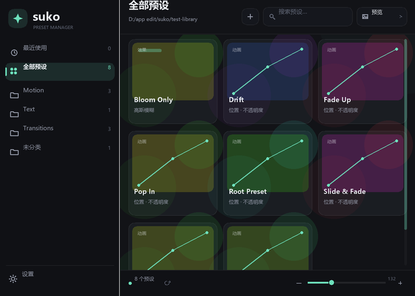

# suko

suko 是 EffectCraft 的 `.ecpreset` 预设管理器，以 ScriptUI 面板形式运行。深色界面、可停靠缩放，支持第一层文件夹、二级文件夹、搜索、单列预设列表、缩放滑杆和首次使用引导。

EffectCraft 0.21.0 的 Effects & Presets 面板本身没有“保存/添加预设”按钮，但菜单栏里有 **动画 → 保存动画预设…**（对应 `anim.savePreset`）。它保存选中的效果、属性关键帧和表达式，并应用到已有图层；不会新建文字层，也不会打包源文本。suko 在预设列表末尾的 `+` 框里提供同一个功能，省得每次找菜单。

测试版本：EffectCraft 0.21.0（Windows）。



## 安装

1. 把 [`suko.jsx`](suko.jsx) 复制到：
   `%APPDATA%\EffectCraft\Scripts\ScriptUI Panels\suko.jsx`
2. 在 EffectCraft 的 **Window** 菜单中打开 **suko**。
   如果菜单中没有出现，重启一次 EffectCraft。
3. 在 **Preferences ▸ Scripting & Expressions** 中开启
   **Allow Scripts to Write Files and Access Network**。
   关闭时脚本仍能扫描预设，但无法保存配置和新建预设。

## 首次使用


第一次打开会显示引导页，需要设置两个位置。默认都指向系统文档下的 `suko` 文件夹：

- **预设库文件夹**：`文档\suko`，存放 `.ecpreset` 的根目录。suko 只读取这个目录。
- **suko 路径文件**：`文档\suko\suko.config.json`，用于记住设置；默认和预设库放在同一个 `suko` 文件夹里。

两个路径都可以点字段直接输入，或点 **浏览** 选择文件夹。默认使用同一个目录，也可以拆成两个不同目录。设置错了可以随时从左下角 **设置** 重新修改，也可以点 **重新引导**。设置页右上角有 **中文 / EN** 语言切换；切换后主界面、设置、菜单和主要提示会立即切换，并写入配置。

## 使用

- **左侧文件夹**：只显示预设库根目录下的第一层文件夹，符合“根目录 → 分类 → 预设”的层级；列表下方有一个同类型的 `+` 框，点击即可新建第一层文件夹（输入名称后立即创建并扫描）。最下面是设置。面板较窄时自动变成图标栏，悬停图标可看名称；根目录只作为文件夹容器，不直接放 `.ecpreset`。
- **搜索下方的二级文件夹**：当前一级分类下的子文件夹横向排列，用 chip 切换；第一个 chip 是“根目录”，只显示一级文件夹里直属的预设，不读取二级文件夹里的内容。最右侧有 `+`，可直接新建二级文件夹并追加到右侧；超出宽度时出现横向滚动条，不会换行重叠。没有二级文件夹时不占一行，预设直接显示。
- **三级结构**：根目录 → 第一层文件夹 → 第二层文件夹 → 预设。左侧只负责第一层，搜索下方负责第二层，右下列表显示当前层的预设。suko 根目录只作为容器，不会把根级文件显示成分类。
- **搜索**：点搜索框，在弹出的小窗口中输入关键词；支持清空。
- **预设列表**：固定为单列条状显示，只显示预设名（不带 `.ecpreset` 后缀、不显示灰色重复路径、不显示扩展名徽章）；字号已整体放大。列表右侧留出独立滚动条，不与预设行重叠；滚动条已加粗。
- **缩放**：拖动底部滑杆或点 `-` / `+`，改变列表行的字号/行高；滑杆已加粗并扩大命中区。
- **删除预设**：右键卡片 → **删除预设** → 确认。只删除磁盘上的 `.ecpreset` 文件，不会动当前项目。
- **列表行**：左侧色条只作分类/随机色标识，不再绘制伪造的缩略图或前后对比；suko 不会用假预览暗示预设效果。
- **应用预设**：选中时间线图层后，双击预设卡片，或右键卡片选 **应用预设**。没有选中图层时会提示；应用过程包在一个撤销组里。文字动画预设如果目标文字层还没有对应 animator，suko 会先创建同名 animator 再应用；非文字层会明确提示“这个预设需要文字图层”。
- **保存预设**：在时间线选中要保存的属性/效果；预设列表始终在末尾追加一个只有居中 `+` 的预设框——0 个预设时它在第 1 位，已有 1 个时在第 2 位，依次后移。点它输入名称即可保存到当前文件夹。顶部不再放保存加号。
- **删除文件夹**：右键左侧一级文件夹，或右键搜索下方二级文件夹 chip，选择“删除文件夹”；确认后会连文件夹内的预设和子文件夹一起删除，无法恢复。删除当前选中的一级/二级文件夹后会自动切回有效分类。

- **刷新**：从外部放入/删除 `.ecpreset` 后，点底部刷新按钮重新扫描。

## 预设库结构

suko 扫描三级结构（根目录 → 第一层文件夹 → 第二层文件夹）：

```text
预设库/
├─ Motion/
│  ├─ Pop In.ecpreset
│  └─ Soft/
│     └─ Drift.ecpreset
└─ Transitions/
   └─ Glitch/
      └─ Stutter.ecpreset
```

- 第一层目录显示在左侧，第二层目录显示在搜索下方；左侧列表下方的 `+` 框新建第一层，二级文件夹行的 `+` 新建第二层。suko 根目录只作为容器，不直接放预设。
- 更深层的目录不会扫描；预设只放在这两层文件夹里。
- 只识别 `.ecpreset`；`.ffx` 目前不支持。
- 缩略图是根据预设 JSON 中的关键帧/效果即时绘制的示意曲线，不是真实渲染图。

## 配置与排错

- 配置：用户选定的配置目录下的 `suko.config.json`。
- 应用内备份：`app.settings` 的 `suko/state`。
- 错误日志：配置目录下的 `suko-error.log`（初始化阶段则优先写到默认配置目录）。
- 如果预设库路径不存在，主界面会显示空状态；可以在设置里重新选择，或点「重新引导」。

## 已知限制

EffectCraft 的 ScriptUI 与 AE 存在差异，suko 已针对这些差异规避：

- `Folder.selectDialog` 返回 `null`，所以文件夹选择器是脚本自建的。
- 面板 canvas 收不到可靠的键盘事件，所以搜索和路径手输使用弹出式文本窗口。
- 没有滚轮事件；滚动用右侧滚动条、拖动空白区域或 PageUp/PageDown（部分环境键盘事件不可用）。滑杆缩放同样收不到滚轮，请直接拖动滑杆或点 `-` / `+`。
- 不支持 `.ffx` 和真实渲染缩略图。

## 开发辅助

- [`tools/ecctl.mjs`](tools/ecctl.mjs)：通过本机控制通道执行 `engine.execute` 的小工具。
- [`tools/render-draw.py`](tools/render-draw.py)：把 `scriptui.get` 的 draw JSON 渲染成 PNG，便于无窗口视觉检查。
- [`test-library/`](test-library)：8 个示例预设，覆盖一级/二级目录、效果预设和未分类。

更多界面截图在 `docs/`；旧版三模式截图可能仍包含已删除的预览/预设切换。
